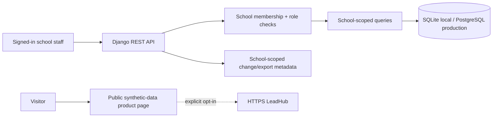
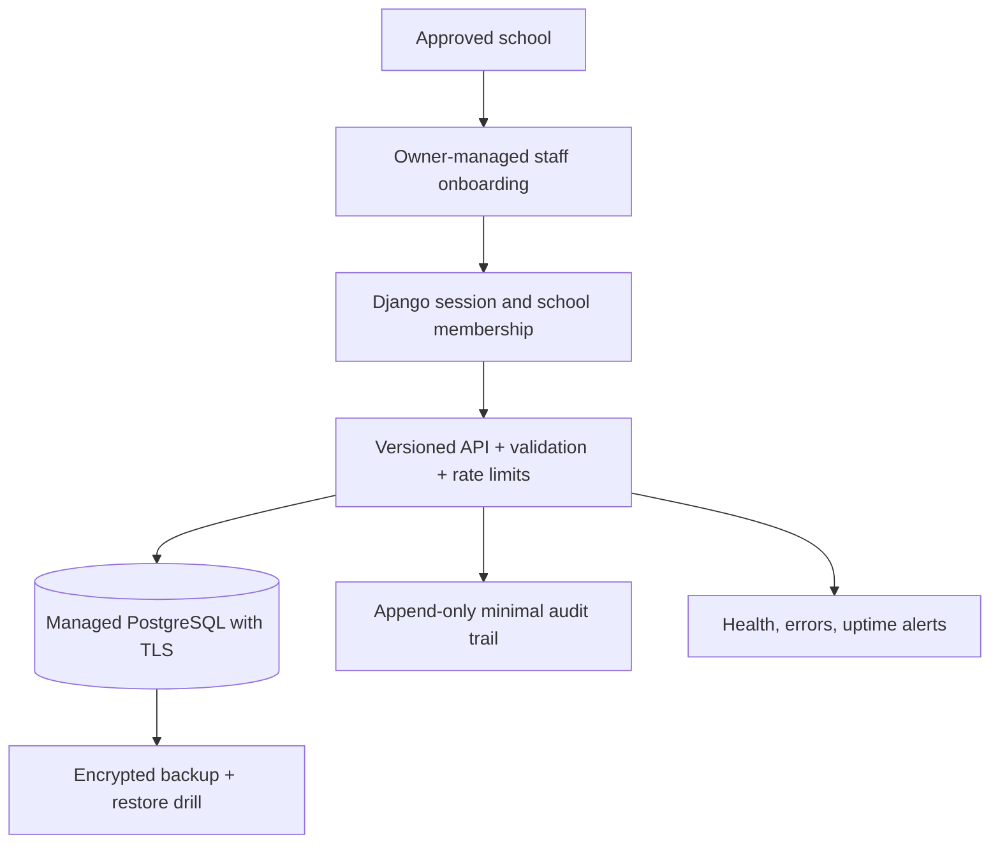

# CampusFlow architecture

## Current system

CampusFlow is a Django REST API with school-scoped student marks and a synthetic-data product page. Local development uses SQLite; production requires PostgreSQL and TLS. Staff accounts are created through Django admin/management commands; there is no school self-service signup or billing.

## Data and permission boundary

- Student names, marks, dates, exports, and audit records are sensitive educational records. The public landing page and health route must never expose them.
- Every student query and export is scoped through the authenticated staff member's school membership. The browser cannot select a school by supplying an arbitrary tenant ID.
- The current audit records identify actor, action, record, and time but do not retain old/new mark values. Deletion is not exposed.
- The LeadHub form, when configured, collects an explicitly consented contact address only; it must never receive student or school records.
- Synthetic examples are required for demos, screenshots, tests, and public marketing until a written school data-handling agreement and qualified privacy review exist.

## Future production boundary (not implemented)

Before real records: approve lawful basis/notice, guardian requirements, data residency, retention/deletion, staff offboarding, incident response, managed database, backup/restore, monitoring, support contact, and a pilot contract. No current deployment or revenue is proof of these controls.
